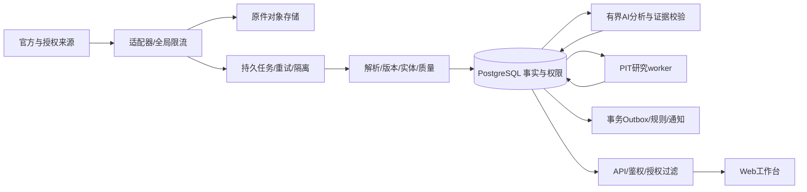

# 美股事件驱动 AI 金融情报与决策支持系统 PRD

版本：1.0 · 编制与官方资料核查日：2026-11-14（Asia/Shanghai）  
状态：可进入工程设计与离线开发；商业数据授权、运营法域和付费生产发布仍有上线门禁。  
配套文档：[开发计划与任务清单](02-分阶段开发计划与任务清单.md)、[Codex 启动提示词](03-Codex启动提示词.md)、[官方来源与决策依据](04-官方来源与核查记录.md)。

## 1. 产品定义与决策原则

为持有周期约 1—20 个交易日的美股事件驱动和波段投资者，提供“发生了什么—证据是什么—影响谁—历史上怎样—未来看什么—我的逻辑是否失效”的研究闭环。产品输出可核查研究材料、条件和提醒，由用户作出投资决策。

首版不执行交易，不保管资金，不承诺收益，不输出未经校准的上涨概率。研究优先级、证据质量、历史样本比例和未来预测概率必须分开表达。AI 无权将推断写成事实，历史相关性不得标注为已证明的因果关系。

产品差异化假设是节省跨来源研究与复盘时间，而非声称券商和竞品没有类似功能。此假设需要用户访谈和付费测试；本 PRD 不将其视为已经验证的市场结论。

### 1.1 目标用户与作业

| 用户 | 触发情境 | 必须完成的作业 | 首版边界 |
|---|---|---|---|
| 独立事件交易者 | 财报、指引、监管文件发生变化 | 快速理解证据、反证、相关资产和待验证条件 | 核心用户 |
| 短期波段投资者 | 盘前筛选和盘后复盘 | 找到与自选和持仓有关的重要变化 | 核心用户 |
| 小型研究团队 | 多人跟踪同一主题 | 保留研究依据与决策版本 | 后期协作 |
| 日内高频、期权专业交易者 | 秒级交易与复杂结构交易 | 超低延迟、盘口、希腊值 | 首版不服务 |

典型主流程：打开工作台 → 筛选重要事件 → 读原文与分析 → 看历史研究及限制 → 加入观察或创建投资逻辑 → 配置失效条件 → 收到提醒 → 记录复盘。

### 1.2 成功指标与研究验证

以下均为计划目标，不是现有业绩。访谈至少 10 名目标用户；邀请至少 5 名试用者连续完成 5 个交易日任务，比较使用前后的同类研究耗时并记录中位数，不声称严格因果。记录事件点击到证据打开比例、创建逻辑比例、有效提醒反馈率、每活跃用户研究成本、周留存。MVP 是否商业成立由访谈、真实使用和付费意愿共同决定，不能仅由技术指标判断。

上线技术门禁：支持数据类型的契约验证全部通过；发布的事实主张均有可定位证据；越权访问和前视泄漏关键测试零失败。分析正确性通过人工标注集评估，不能用“JSON 合法率”代替准确率。

## 2. 范围与版本

| 能力 | MVP：研究闭环 | V1：受控扩大 | V2：数据与模型条件满足后 |
|---|---|---|---|
| 事件 | SEC 8-K、10-Q、10-K；财报/指引/重大披露；FOMC、CPI、就业日历 | 经授权新闻、电话会、监管事件 | 跨语言与多市场实时流 |
| 资产 | 50 家试点公司，少量市场/行业 ETF；稳定资产 ID | 扩展覆盖，历史退市证券 | 全球多资产 |
| 图谱 | 有证据的事件—公司—行业—ETF，一跳为主 | 供应链和业务敞口，最多两跳 | 路径搜索与情景传播 |
| 历史验证 | 日频事件研究；PIT 数据门禁；固定条件和窗口 | 规则策略回测、走步验证 | 分钟级、期权和复杂执行 |
| AI | 结构化摘要、影响假设、反证、引用与审计 | 多来源冲突分析、人工审阅队列 | 经独立验证的概率模型 |
| 日历 | 来源确认/暂定/未知时间、修订提醒 | 授权财报日历、预期快照 | 更广催化剂与跨资产联动 |
| 雷达 | 显式偏好与可解释规则排序 | 个性化实验、严格离线评估 | 学习排序与校准预测 |
| 风险 | 手工/CSV 持仓、事件敞口、逻辑条件监控 | 只读券商同步、相关性分析 | 经批准的情景风险与组合工具 |
| 通知 | 站内通知、摘要和静默时段 | 用户主动订阅邮件/Web Push | 更多渠道 |
| 商业化 | 受邀试用、配额、授权控制 | 订阅与团队席位 | 企业集成 |

MVP 不含订单路由、自动交易、交易指令生成、实时盘口、期权流、社交跟单、黑盒买卖评分和无来源“市场一致预期”。没有授权行情时仍能运行事件证据工作流，但历史验证界面明确显示“未配置数据”，不得以模拟结果冒充实盘研究。该状态可验收离线原型，不可宣称已完成生产历史验证。

## 3. 功能要求与用户验收

### FR-01 事件采集、归一化和生命周期（MVP）

输入源文档后，保存不可变原件与哈希、来源版本和时间精度，再解析实体、事件类型和事实主张。一级事件类型固定枚举：`earnings_release / guidance_change / material_disclosure / macro_release / monetary_policy / other`。不支持的类型进入 other 和待审，不由模型随意添加枚举。

一个文档可产生多个事件，一个事件可关联多个文档。按 accession/官方 ID 做精确去重；语义近重复仅建议聚类，保留原文与来源独立性，转载不得计为独立证实。更正、修订与撤回形成新版本，旧版本可访问。状态为 `candidate → validated → published → corrected/retracted`；隔离是独立质量状态 `quarantined`，失败不发布。

验收：同一 accession 重放 10 次只产生一个来源版本；修订文件不覆盖原版本；两个主体同日财报不误合并；撤回使依赖分析过期且产生一次用户可见更正通知。合并/拆分保留原 ID 的重定向和审计记录。

### FR-02 可审计事件详情（MVP）

详情包含事件版本、时间线、已证实事实、影响机制假设、受影响资产、相反证据、未知项、未来验证条件、相关催化剂及数据截至时间。事实与推断使用不同标签；“为什么上涨/下跌”只呈现有依据的可能驱动及同期市场/行业对照，不强行给唯一原因。

每项外部可核查主张必须指向特定 document_version、原文位置和证据片段；引用跳转至证据抽屉。无足够材料显示“证据不足”；来源冲突并列展示，不以多数投票消除冲突。摘要默认中文，保留英文原始指标与单位。

验收：引用可从保存的原文复现；无效引用阻止发布；无材料、解析失败、模型拒绝、额度耗尽均有明确界面；旧分析显示“已过期/来源已修订”，不能静默更换正文。

### FR-03 事件—资产知识图谱（MVP）

节点：Event、Company、Instrument、Industry、MacroFactor、Document。Company 与 Instrument 分离，CIK 不是证券 ID，ticker 只是有有效期的别名。ETF 成分和行业归属必须有时间版本。

关系白名单：`document_supports_event / event_directly_affects_company / company_issues_instrument / company_in_industry / instrument_member_of_etf / event_exposes_factor`。后期扩展 `supplier_of / customer_of / competes_with`，不得仅凭模型常识确认为事实。

每条边保存方向、有效区间、可知时间、证据、提取方法、review_status、版本、失效原因。直接影响和间接映射分开；图谱路径只代表研究关联。MVP 通过 PostgreSQL 关系表和递归查询实现，无须引入图数据库。资产页面以列表为默认，图形可切换。

验收：用户点击任意边能见依据；截至时间之前不存在的关系不能出现在历史路径中；无成分数据时不得声称精确 ETF 穿透；事件影响为未知时不得填正向/负向。

### FR-04 催化剂日历（MVP）

日/周/列表视图；筛选自选、事件类型和重要性。字段包括 `scheduled_start/end`、原始时区、精度（minute/day/window/unknown）、`confirmation_status`、来源、上次检查、修订版本、实际发布时刻。盘前 BMO、盘后 AMC 为时间窗口，不转换成伪精确时刻。会议日期和决议公布日期分成不同节点。

日历变更用稳定 calendar_item_id + revision 更新，ICS UID 稳定、SEQUENCE 递增、取消保留状态。暂定日期显示“暂定”；过去未发布项显示“延期/待核实”，不自动写成已发生。FRED 发布日期不当作系统收到数据的时间。[S3—S7]

验收：夏令时切换、休市、半日市和亚洲跨日正确；日程改期不会留下重复提醒；未知时间不显示精确倒计时；用户可选择 America/New_York 和 Asia/Shanghai。

### FR-05 个性化机会雷达（MVP）

配置自选、主题、事件类型、研究周期、流动性下限、是否展示间接关联。采用显式规则，不从浏览行为隐式推断投资适当性。筛选先执行授权和质量门禁，再执行偏好过滤和评分。

默认规则版本 radar_v1：五项均为 0—1 的确定性特征，`score=100*(0.30*relevance + 0.25*materiality + 0.20*evidence_quality + 0.15*novelty + 0.10*urgency)`。这些权重是待验证产品参数。relevance：自选直接=1、关注行业=0.6、其他=0.2；materiality：经批准类型表取值；evidence_quality：已定位一手来源=1、授权二手=0.6、未核实=0；novelty：新事件=1、实质修订=0.7、重复=0；urgency：确认且未来 24h=1、72h=0.7、7日=0.3、其余=0。无已确认日程的已发生事件 urgency=0。缺特征按 0 计并列缺失项，不临时重分权重。未核实事件只在待核实视图，不进入默认排名。

同分按 known_at 降序再 event_id；保存特征、权重、来源与运行版本。看多、看空、中性都是研究方向标签，不参与“收益概率”解释。

验收：每条结果解释“为何与你相关”和每项分值；同一输入与版本排序一致；用户可排除股票和主题；不得把 85 分写成 85% 胜率。历史评分只使用当时偏好版本和可知信息。

### FR-06 历史事件研究（MVP）

用户从事件详情选择预设模板，获取相似条件事件样本、分布、个例和研究限制。事件研究描述事件之后的价格表现，不能据此宣称可执行策略收益；策略回测是 V1 独立功能。详细方法见第 6 节。

验收：无足够 PIT 数据时返回阻断码或仅展示样本清单；任何统计都可以追溯到样本、价格版本、筛选配置及计算代码；不得生成演示胜率用于产品宣传。

### FR-07 风险与投资逻辑监控（MVP）

持仓支持手工和受限 CSV 导入：instrument_id、quantity、currency、可选成本和 as_of。价格旧则组合权重标注过期；未配置价格时只按持仓数量列事件关联，不计算伪实时损益。CSV 映射预览、逐行错误、确认后原子提交，防公式注入，限制文件大小和行数。

逻辑卡包含：用户论点、资产、建立时间、周期、支持/反对证据、催化剂、可计算失效条件、复核日期、状态。条件使用安全 DSL：例如 `metric(guidance_revenue).latest < decimal('...')`，字段与操作符白名单，不能执行任意代码。MVP 只支持指标阈值、指定类型事件、催化剂临近、时间到期，不用自由文本判定作为唯一触发器。

条件计算使用 `true/false/unknown` 三值逻辑；数据缺失或过期为 unknown，不等于逻辑仍有效。状态 `draft/active/needs_review/invalidated/closed`；系统可转 needs_review，最终 invalidated/closed 由用户确认，原始触发保留。风险页显示事件集中、行业集中和数据覆盖，不提供未经模型验证的违约/亏损概率。

验收：同一事件版本每条规则只触发一次；更正后重评并发更正，不抹去旧提醒；用户忽略与关闭均审计；共享行业重复暴露不把同一市值计两次。

### FR-08 通知、复盘与管理（MVP）

站内通知提供事件、引用摘要、触发条件、数据时间和跳转；去重键包含 tenant/user/rule/event_revision/channel。静默时段按用户时区，摘要通知可合并；关键级别不自行绕过用户设置。待发送任务重试带幂等键，外部渠道无法严格保证 exactly-once，记录 provider_message_id 和不确定状态。首版站内为主，不默认发送邮件。

复盘记录关注、忽略、修改逻辑和用户判断，不把“点击了”解释为推荐正确。后台含采集水位、隔离队列、实体歧义、来源失效、授权过期、分析审阅和审计查询；管理员更正必须写原因。

## 4. 数据供应与质量契约

### 4.1 来源优先级及准入

| 数据 | 首版来源/方案 | 质量与授权门禁 | 缺失降级 |
|---|---|---|---|
| SEC 文档及结构化事实 | 官方 submissions、Archives、XBRL API [S1/S2] | User-Agent、全局限流、保留 accession/原文；指标需上下文 | 保留文档入口，停用数值分析 |
| 宏观时间序列 | FRED/ALFRED 指定 series 和 vintage [S3/S4] | API key；逐系列检查使用条款与精度 | 不计算 surprise 或同日预测 |
| 宏观日历 | BLS 官方 ICS、Fed 官方日历 [S6/S7] | 来源修订、时区和时间精度 | 标“暂定/待核实” |
| 财报及指引 | SEC 附件和公司 IR，经来源级审查 | GAAP/non-GAAP、财季和单位区分 | 只摘要有出处部分 |
| 历史日线/公司行动/证券主表 | 待选商业供应商，通过统一适配器 | 退市、拆并股、分红、历史 ticker、PIT 元数据、再分发/派生/AI 使用授权 | mock 原型；禁止生产统计 |
| 市场一致预期、新闻、电话会 | MVP 不采购不依赖 | 需要当时快照和对应授权 | 显示“未接入”，不自行生成 |

试点范围使用版本化 `universe.yml`，至少覆盖不同行业、改名或换 ticker 场景。50 家当前公司只是产品覆盖范围；不得拿今天的这 50 家充作无幸存者偏差的全市场历史样本。

供应商评审必须用同一验收包检查历史标识、退市终值、复权算法、修订日志、时间戳含义、补录策略、限流、SLA、数据保存/导出/模型输入权利及报价。不在没有合同的情况下写“某套餐一定支持”。行情不默认实时；每张行情卡必须显示 session、delay、as_of、currency、source。

### 4.2 全局数据规则（强制）

1. 标识：主键 UUID；外部 accession/CIK/供应商 ID 为别名。ticker 必须与交易所及有效期组合解析。无法唯一识别进入歧义队列，不能硬匹配。
2. 时间：API 使用 RFC3339 UTC；源时区使用 IANA。date 与 timestamp 不混用；保留原始文本、精度、转换规则。NYSE 日历为可版本化依赖，不能用“周一到周五”替代。[S5]
3. 数值：价格、金额和比例使用 decimal，JSON 为十进制字符串，PostgreSQL NUMERIC；所有值附 unit、currency、scale、period、basis（GAAP/non-GAAP）、是否季调等上下文。缺失值 null + reason，不以 0、空字符串或 NaN 代替；禁止用 binary float 对账。
4. 版本：原文、规范化事实、关系、日历和分析均不可变版本。删除/撤回使用 tombstone；服务视图选取当前版本，历史版本不覆写。
5. 溯源：事实需 source_version_id、locator、content_hash、parser_version、时间来源。证据片段采用统一规范化文本的 UTF-8 字节区间，保留原文页码/section 映射，避免中英文字符偏移不一致。
6. 质量：`raw/validated/quarantined`；记录字段级 issue、严重度与处理者。冲突值可共存，注明 provenance 和优先规则，不混平均。
7. 许可：license_policy_id 随数据流传播到缓存、分析、下载和通知；最严格组合权限生效；许可变更主动失效缓存与导出链接。
8. 契约：Pydantic 为规范化领域模型真源，生成 JSON Schema 与 OpenAPI，再生成 TS 客户端；`additionalProperties:false`。LLM 支持的 JSON Schema 子集单独适配，不声称完整领域 Schema 可直接传入模型。[S8]
9. 幂等：摄取使用 `(provider, external_id, revision/content_hash)` 唯一键；输出使用事务与 outbox，任务至少一次执行，业务结果逻辑去重。
10. Schema 演进：字段新增仍须版本与兼容检查；破坏性变更提升 major，提供迁移与双读窗口，禁止消费端静默忽略未知枚举。

### 4.3 双时间与可知时间

| 字段 | 定义 | 是否用于信息可用性门禁 |
|---|---|---|
| occurred_at / scheduled_at | 现实事件发生/预计时间 | 否，单独不能证明已知 |
| source_published_at | 来源声称的发布时刻，可为空 | 与证据组合 |
| provider_available_at | 供应商证明此版本可用的时刻 | market 模式依据之一 |
| first_seen_at | 本系统首次收到原件时刻 | system 模式依据 |
| processed_at | 规范化输出生成时刻 | system 派生数据依据 |
| known_at | 该版本在所选知识模式的可用下界 | 是 |
| valid_from/to | 该事实描述现实状态的有效区间 | 防止今天关系反写历史 |
| system_from/to | 数据库版本在系统中的存在区间 | 审计与系统回放 |

固定两种知识模式，接口必须显式选择：`system_observed` 使用本系统实际收到并生成该依赖的时刻；`market_reconstructed` 使用有证据的历史公开/供应商可用时间，包含保守处理延迟，标注重建而非实际系统绩效。没有历史可用时间不能倒填为 occurred_at。known_at 是每个数据版本的字段，不能在历史查询中用今天的当前记录替代。

原始数据与派生数据区别：system 模式派生 known_at 不早于 processed_at 及所有输入 known_at；market 模式历史派生结果只有在变换方法允许历史重建、所有输入均已知且模型无后见知识风险时才能进入策略信号。事后用当代 LLM 整理旧文档可供研究展示，默认禁止用作当年的可交易信号。既存知识图谱路径、实体解析和自选偏好也都要做时间门禁。

仅 vintage date 的 ALFRED 数据标为 day 精度：首版保守设为该纽约自然日结束后可用于后续交易日，不能作为同日开盘前特征。若找到可验证的原始发布和首次版本，另建来源版本并记录方法，不静默升级精度。[S3/S4]

### 4.4 示例：事件 API 对象（虚构测试数据）

下例 ID、公司、指标均为测试夹具，不代表真实证券事件。

```json
{
  "schema_version": "1.0.0",
  "event_id": "10000000-0000-4000-8000-000000000001",
  "revision": 1,
  "event_type": "guidance_change",
  "status": "published",
  "quality_status": "validated",
  "title": "示例公司调整收入指引",
  "source_published_at": "2025-02-03T21:15:00Z",
  "first_seen_at": "2025-02-03T21:16:00Z",
  "known_at": "2025-02-03T21:16:20Z",
  "knowledge_mode": "system_observed",
  "time_precision": "minute",
  "source_version_ids": ["20000000-0000-4000-8000-000000000001"],
  "instrument_ids": ["30000000-0000-4000-8000-000000000001"],
  "license_policy_id": "fixture-only",
  "supersedes_revision": null
}
```

事件内指标保存在 `event_facts`，不靠 title 解析数值。指标最小字段：metric_key、value、unit、currency、period_start/end、fiscal_year/quarter、basis、evidence_id。指引区间保存 lower/upper，不用中点冒充原始披露。surprise 仅在 actual 与 pre-release consensus 同口径且后者 known_at < release_at 时计算；分母为零返回 null，明确使用 absolute_delta 或 relative_delta，不能混淆百分点与百分比。

## 5. 领域数据模型与存储

所有版本表含 created_at、schema_version；所有私有表含 tenant_id，所有可历史查询的公共事实含 known_at、有效区间、知识模式或对应时间证据。此表是实现约束，完整建表由迁移产出。

| 表/聚合 | 关键字段与约束 |
|---|---|
| tenants/users/memberships | tenant、OIDC subject、角色；tenant+subject 唯一 |
| sources/license_policies/entitlements | 来源能力、授权范围、期限、可显示/导出/模型输入/派生权限 |
| source_documents/document_versions | document_id、external_id、version、URI、sha256、原始/规范化对象地址、源时间和精度；source+external_id+hash 唯一 |
| evidence_spans | version_id、start_byte/end_byte、quote_hash、section/page；检查范围合法 |
| entities/instruments/instrument_aliases | company/entity、instrument、asset_class、MIC、ticker、valid/system interval；同市场别名有效期不能冲突 |
| events/event_versions/event_documents | 稳定事件 ID、类型、状态、版本、时间、来源；event_id+revision 唯一 |
| event_facts | event_revision、指标全上下文、decimal、evidence_id、known_at |
| graph_edge_versions | src/dst typed ID、relation_type、valid/known/system times、evidence、review_status；白名单端点类型校验 |
| calendar_items/calendar_revisions | 稳定 UID、scheduled window、确认度、状态、来源、revision |
| price_bar_versions | instrument、session_date、interval、OHLCV、currency、vendor_revision、known_at、adjustment_basis；键包括版本 |
| corporate_action_versions | split/dividend/delist、ex/pay dates、ratio/cash、来源、known_at；原始行情与复权派生分开 |
| macro_observation_versions/consensus_snapshots | series、observation_period、vintage、value/context、known_at；预期表 V1 启用 |
| universe_memberships | universe_version、instrument、valid interval、known_at、inclusion_reason |
| analysis_runs/analysis_claims | 输入快照哈希、event_revision、模型/提示词/检索/代码版本、输出、校验结果、成本、状态、过期原因 |
| research_runs/research_samples | 配置、知识模式、数据快照、代码 hash、样本与排除原因、指标、manifest |
| watchlists/preferences/positions | tenant/user、版本、资产、quantity、as_of；positions 不存账户凭据 |
| theses/thesis_versions/monitor_rules | 用户论点、条件 AST、状态、版本、last_evaluated_at |
| radar_runs/radar_items | tenant/user、pref_version、规则/特征版本、截至时间、分项分数 |
| notifications/outbox/delivery_attempts | 去重键、payload_hash、重试次数、发送状态、可见状态 |
| audit_log/jobs/ingestion_checkpoints | actor、tenant、action、resource/version、trace、before/after hash、失败码、水位 |

索引：event_versions(type,known_at DESC)、event_assets(instrument_id,event_id)、document_versions(source_id,external_id)、graph(src,relation,known_at)、prices(instrument_id,session_date,known_at DESC)、私有表(tenant_id,user_id,updated_at)。时序表按月/年分区须以实际量测决定。embedding 是可重建索引，保存 embedding_model、chunk_hash、source_version 与权限，不作为事实真源。

## 6. Point-in-time 历史研究与回测规范

### 6.1 研究运行的必填输入

`template_version, event_type, universe_version, start/end, as_of, knowledge_mode, dataset_snapshot_id, calendar_version, feature_rules_version, benchmark_id, entry_rule, horizons, costs, exclusions, random_seed, code_commit`。MVP horizon 固定 1/5/10/20 交易日；可选的维度限于当时可知的事件类型、行业、规模和滞后波动率。今天知道的事后“利好/利空”不得作为历史筛选标签。

研究运行创建后冻结配置，禁止覆盖；重跑产生新 ID。数据清单包含每个依赖的 ID、版本、哈希、授权和时间证明。复现承诺是确定性计算及保留的 AI 输出可重放，不承诺再次调用同一模型得到逐字相同文本。

### 6.2 截至时点查询与反前视

对每一历史决策时刻 t，先筛 `known_at <= t` 的版本，再选择该时刻可见的最后版本，不能先选今天最新版再回看。有效区间、系统区间按知识模式分别解释；特征只用 t 之前完成的 bar、已公布财报和当时 universe。未来的更正/拆股/行业变更不能进入过去的特征。

每个特征保留 input_max_known_at，必须不大于 signal_cutoff。未来价格允许作为 outcome，必须与特征库物理或逻辑隔离；相似事件候选在用户研究 as_of 前须已发生，计算某个 horizon 统计只使用 outcome 在研究 as_of 前完整可得的样本。尚未成熟样本显示 pending，不提前泄漏之后收益。

测试至少包含：财报后补录、财报重述、ticker 改名、退市、宏观修订、日期精度不足、同 bar 收盘信号、历史图谱后建关系、供应商历史修订和跨夏令时。

### 6.3 MVP 入场、收益和基准

只支持常规交易时段日频研究。入场为“signal_known_at + 配置延迟之后的下一个常规交易时段开盘”，严格早于开盘才可用该开盘；不使用本 bar 的收盘特征成交在同一收盘。盘中、盘后和无精确时间事件统一保守延后。时间未知且无法确定安全开盘的样本剔除。

持有 h 个交易时段定义：入场会话为第 1 个，退出价为第 h 个会话收盘；界面必须展示定义，不能与 open-to-open 混用。基准使用同会话开/收盘口径，基准缺失的样本不参与超额统计，但在排除清单保留。

原始成交价格配合拆股调整持股数量、按总回报口径处理现金分红；明确分红再投资假设和收益币种。未来复权因子不能用于构建历史价格阈值特征。退市需供应商终值/兑付处理，无数据必须剔除并披露偏差，不能默认为 0 收益或用最后价格无限持有。停牌无开盘价时不填充可成交价格，按预注册规则延后最多 5 个交易日，否则记为不可成交并报告比例。

`raw_return = ending_wealth / initial_wealth - 1`；买入滑点/成本增加初始支出，卖出滑点/成本减少终值，分别列 gross 和 net；`abnormal_return = asset_total_return - benchmark_total_return` 为首版明确定义，不冒充回归 alpha。参数化每边 commission_bps 和 slippage_bps，默认值是研究假设，在报告顶端显式展示且不得称为真实券商成本。MVP 不计算做空和杠杆收益。

### 6.4 统计输出与限制

输出原始事件数、独立公司数、事件日期簇数、每 horizon 完整样本数、剔除数及原因、均值/中位数、P10/P25/P75/P90、正收益占比、基准超额和置信区间。正收益占比仅指样本 outcome > 0，不叫未来胜率。n<30 不显示聚合比例和置信区间，只列样本并标“样本不足”；n>=30 仍不代表可靠预测。

同公司相邻事件默认保留最早、冷却 20 个交易日，其他记重叠剔除；共享宏观冲击导致的跨公司依赖以日期聚类区间估计并披露。可配置聚类 bootstrap、固定随机种子与重复次数，样本簇过少则不显示区间。所有筛选变更视为新实验；记录试验次数，MVP 不展示挑选后的“最佳策略”。

V1 策略回测还须有现金/持仓账本、信号冻结、成交模拟、仓位约束、重复持仓、流动性、成本敏感性、最大回撤及换手。训练/验证/测试按时间分割，重叠标签 purge + embargo 长度至少最长持有窗口，走步训练；隔离最终测试集与参数搜索。模型预测概率必须另行做样本外 Brier、校准曲线等评估，不沿用事件样本比例。

### 6.5 数据门禁

运行可能状态 `queued/running/succeeded/partial/blocked/failed/cancelled`。阻断码：`NO_PIT_AVAILABILITY / NO_LICENSE / NO_PRICE_HISTORY / UNRESOLVED_ENTITY / NO_UNIVERSE_HISTORY / UNSUPPORTED_TIME_PRECISION`。每个样本可有更细排除原因。固定当前股票集合的研究可以作为“指定集合描述研究”，必须显著标记幸存者偏差，不能标成无偏策略回测。

## 7. AI 分析、证据与安全

流水线：获取授权快照 → 文档清洗/分段 → 规则解析财务表与实体候选 → 受控提取 → 证据校验 → 影响假设 → 反证检索 → 数值与时序校验 → 发布或待审。MVP 使用有界编排，无需自由运行的多 Agent；每步超时、预算、重试和可观测。

LLM 只接收已授权、截至时点内的 chunks，外部文档一律作为不可信数据；其中的“忽略系统规则/发邮件/执行命令”等内容不得触发工具。工具只读、参数 Schema 校验、来源域白名单和 SSRF 防护；模型不直接写事实表、不访问私钥、不运行 SQL/任意代码。检索先过滤 tenant、license、known_at 再排序，禁止先检索后只在 UI 隐藏。

输出领域结构：

```text
analysis_id, event_id, event_revision, as_of, knowledge_mode,
status: complete | insufficient_evidence | needs_review | refused | failed,
facts: [{claim_id, statement, fact_ids[], evidence_ids[]}],
hypotheses: [{claim_id, mechanism, instrument_ids[], direction:
  positive|negative|mixed|unknown, supporting_evidence_ids[],
  contradicting_evidence_ids[], assumptions[], invalidation_conditions[]}],
unknowns[], next_catalyst_ids[], evidence_quality: high|medium|low,
limitations[], input_snapshot_id, prompt_version, model_id,
validator_version, generated_at, expires_on_source_change
```

所有数组可为空；缺值必须明确，不能为满足 Schema 编造。模型置信自评不能作为统计概率。系统校验：引用存在、位置和 hash 一致、claim 对应文本、数值单位/时间/口径一致、实体合法、来源非撤回且在截至时间内。引用存在不等于主张被支持，语义支持要用人工标注和抽检；二次模型检查只作辅助。[S8]

审计保存模型实际 ID/可用快照、提示词版本及哈希、检索 query 和 chunk 列表、输入/输出 hash、工具调用、用量、延迟、校验错误、审阅人、代码版本。保留可解释的结论依据，不要求采集或展示模型内部思维链。模型或 SDK 版本由 ADR 固定，更新先跑评估，不在文档中指定未经账户验证可用的最新型号。

评估集首版至少 100 个有权使用的文档案例，涵盖冲突、修订、数值单位、无证据、注入攻击；另建不少于 30 个留出案例且不用于改提示词。标注 claim 支持/矛盾/不足，双人复核有争议样本。计划门槛：留出集事实主张支持率 ≥95%，数值/单位正确率 ≥98%，已发布引用有效率 100%，关键越权/前视/注入工具执行为 0。报告分母、置信区间与样本构成；未达门槛关闭自动发布，保留人工审阅模式。以上是验收目标，不是已经测出的精度。

## 8. UI 与交互

桌面优先 1440px，兼容 1024/768/390；中文界面，原文英文可展开。默认中性配色，可设置涨跌红绿习惯，不能只用颜色表达方向。满足关键流程键盘访问、焦点可见、表格语义与 AA 对比度要求。

导航：工作台 / 事件流 / 催化剂 / 历史研究 / 自选与持仓 / 投资逻辑 / 设置；后台独立权限入口。

```text
顶部：全局搜索 | 市场会话 | 时间与时区 | 数据状态 | 通知
左侧：导航
工作台主区：今日重要事件（来源、known_at、直接/间接、证据状态）
          个性化雷达（研究优先级、逐项解释、关注/忽略）
右侧：未来72小时催化剂 | 待复核逻辑 | 数据缺口
事件详情：标题与版本 → 事实/假设/反证 → 资产关联 → 历史研究
          右侧证据抽屉 → 原文定位；底部创建逻辑/加入自选
```

| 页面 | 必备组件 | 必备交互和异常状态 |
|---|---|---|
| 工作台/雷达 | 筛选、排序原因、覆盖率、数据水位 | 首次引导；无自选用明确标注的公共事件；无数据不造榜单 |
| 事件流/详情 | 类型/来源/时间筛选、版本差异、引用抽屉、关联列表 | 修订横幅、冲突、撤回、授权不足 |
| 催化剂 | 周/列表视图、时区切换、确认度、ICS | 暂定、延期、取消、未知时刻 |
| 历史研究 | 模板配置、运行状态、分布、样本表、排除项、manifest 下载 | 样本不足、数据阻断、未成熟 outcome |
| 资产/持仓 | 稳定标识、事件、行业、价格 as_of、数据覆盖 | ticker 歧义、CSV 错误、价格过期 |
| 逻辑监控 | 论点版本、条件编辑器、触发记录、用户确认 | unknown 状态、数据源中断、规则停用 |
| 设置/后台 | 时区、静默时段、授权、预算、失败队列 | 过期授权、限流、人工更正审计 |

所有主页面要设计 loading、empty、partial、error、stale、no_permission 六类状态。mock 模式全局持续横幅“模拟数据”；演示数据使用虚构主体或来源明确的合法夹具，不伪造实时行情。历史详情展示固定 as_of，不通过后台刷新自动跳到现在。

## 9. 后端与部署架构

建议模块化单体开始，API 与 worker 分进程；Next.js/TypeScript 前端，FastAPI/Pydantic Python 后端，PostgreSQL（可选 pgvector）、Redis 队列、Celery worker/beat、S3 兼容对象存储。锁定受支持版本与依赖文件；本 PRD 不将某一库的“最新版本”当成要求。



模块：identity、entitlements、ingestion、documents、entities、events、graph、calendar、analysis、research、radar、portfolio、theses、notifications、audit。模块写入只能通过所属服务，避免 worker 直接绕开授权和版本规则。

采集配置按来源设限，SEC 所有进程共享总速率桶，默认上限 5 req/s，包含失败重试且不超过官方当前 10 req/s 指引；User-Agent 标识应用和联系地址。[S2] 支持 ETag/Last-Modified、增量水位、指数退避加 jitter、429 Retry-After、熔断和死信。定期补扫发现漏件，但补录时刻不改写 first_seen_at。定时任务可分批轮询试点 CIK，不能用供应商典型延迟作自己的 SLA。

对象写入后经校验才提交版本及 outbox；孤立对象用定期任务清理。worker 幂等消费；研究重任务独立队列和并发配额，前端请求不阻塞执行回测。Redis 不是唯一持久结果库；任务与结果状态存 PostgreSQL，队列可重建。

初版 Docker Compose 含 web/api/worker/scheduler/postgres/redis/object-storage；开发、测试、生产隔离。生产用托管数据库与对象存储、TLS、Secret Manager、迁移任务及可回滚镜像。API/worker 可分别扩容，只有量测瓶颈后才增加 ClickHouse、专用搜索或 Neo4j。

## 10. API 契约

统一 `/api/v1`，OIDC Bearer/session，经服务端解析用户、成员关系和当前租户；客户端 tenant_id 不可作为授权依据。公共数据也受 license entitlement 约束。

列表使用稳定 cursor，键为 `(known_at,id,revision)`，默认 limit=20、最大100；筛选截至时间绑定 cursor 防止翻页漂移。响应包：`{data, meta:{request_id,as_of,knowledge_mode,data_freshness,warnings,next_cursor}}`。资源详情带 ETag；修改使用 If-Match，过期返回 412。异步创建返回 202 + job_id/location；幂等键在同租户/用户/路由内有效 24h，相同键不同 payload 返回409。

| 方法/路径 | 输入/输出核心 | 权限 |
|---|---|---|
| GET /events | type/instrument_id/known_before/as_of/knowledge_mode/cursor | 已登录且数据授权 |
| GET /events/{id}?revision= | EventDetail、facts、analysis 状态、source refs | 同上 |
| GET /documents/{id}/versions/{v}/evidence/{span} | 授权片段、原文定位；原件下载另鉴权 | 来源授权 |
| GET /instruments/search?q=&as_of= | 带有效期的候选，无唯一则不自动选 | 已登录 |
| GET /graph?root_id=&depth=&as_of= | MVP depth≤1，返回边与证据 | 数据授权 |
| GET /calendar?from=&to=&timezone= | ≤90日窗口、修订和未知精度 | 已登录 |
| POST /research-runs | 第6节冻结配置；202 或阻断 | research 配额 |
| GET /research-runs/{id} | 状态/汇总/排除码/manifest | owner 或明确共享 |
| GET /research-runs/{id}/samples | 分页样本、成熟状态 | 同上 |
| POST /analysis-runs | event_revision/as_of/knowledge_mode；202 | analysis 配额 |
| GET /analysis-runs/{id} | Schema 化分析及审计摘要 | 授权叠加 owner |
| GET /radar | 当前用户偏好和冻结 ranking_run | 本人 |
| PUT /preferences | 完整偏好版本，If-Match | 本人 |
| GET/POST/DELETE /watchlists/{id}/items | 稳定 instrument_id | 本人 |
| POST /position-imports/preview | 受限CSV；映射与错误 token | 本人 |
| POST /position-imports/{id}/commit | 已确认预览版本；幂等提交 | 本人 |
| GET/POST /theses；PATCH /theses/{id} | 论点与安全条件 AST、If-Match | 本人 |
| GET /notifications；POST /notifications/{id}/read | 通知及阅读状态 | 本人 |
| POST /admin/events/{id}/corrections | revision、reason；人工发布门禁 | 数据审阅者 |
| GET /admin/ingestion/status；POST /admin/jobs/{id}/replay | 水位、失败、幂等重放 | 运维角色 |
| GET /health/live；GET /health/ready | 最小健康信息 | public / internal |

错误：`{error:{code,message,details,retryable},request_id}`；400 请求错误、401 未认证、403 授权不足、404 不存在或不可见私有资源、409 幂等冲突、412 版本冲突、422 领域约束、429 配额、503 来源/系统不可用。不得把供应商 key 和原始异常栈暴露给客户端。API 示例、JSON Schema、正反例和错误码必须生成进仓库，文档表格不能代替可执行契约。

## 11. 权限、隐私与合规上线门禁

角色与数据授权分开：viewer 可读许可数据；researcher 可建私有研究/逻辑；data_reviewer 可审阅公共事件但默认不能看用户持仓；tenant_admin 管本租户成员与额度；ops_admin 管任务与来源，无默认用户内容读取权。生产临时 break-glass 访问须审批、限时和审计。

私有表启用 PostgreSQL RLS；运行账户不为表 owner、不具 BYPASSRLS，需要时 FORCE RLS；连接池请求结束重置租户上下文。服务鉴权、RLS 和对象存储签名 URL 三层检查；缓存键含 tenant/user/entitlement/as_of/版本，向量检索和后台任务同样隔离。[S12]

加密传输与静态存储；OIDC 登录，管理员 MFA；CSRF、XSS、CSP、上传校验、SSRF、速率限制、依赖审计与秘密扫描。持仓和用户文本不进入通用模型日志，模型供应商需核查数据保留、训练使用和部署区域政策。分析缓存不得跨租户复用含私有持仓或偏好的内容。

建议产品默认保留策略：私有研究与逻辑至用户删除；原始授权数据按合同；操作日志 90 天、审计日志 1 年、备份 30 天为初始工程配置，正式期限由法务/合同确认，不声称满足任何统一法定年限。删除请求软删立即不可见、30天内主存清除；备份随周期淘汰，法定留存例外记录理由。用户数据导出/删除、模型处理告知和安全事件响应需有操作流程。

| 上线门禁 | 负责人 | 证据与失败行为 |
|---|---|---|
| 数据商业权利 | 产品/采购/法务 | 显示、非显示、派生、AI输入、保留、导出逐项许可；缺项关闭对应功能 [S9] |
| 服务身份与法域 | 法律顾问/业务负责人 | 按实际服务、个性化程度、收费、营销、用户所在地分析顾问/经纪相关义务；免责声明不能自动豁免 |
| 研究与业绩宣传 | 合规/产品 | 方法、样本、成本、限制、假设显著；适用时审查 SEC marketing rule、FINRA 2214，不一概声称适用所有 SaaS [S10/S11] |
| 隐私与安全 | 安全/法务 | 用户地区与数据跨境义务评估、DPA、删除/导出演练；未知市场先限制开放 |
| 生产能力 | 工程/数据负责人 | PIT、AI、权限、恢复和来源失效测试通过；否则受邀离线/人工模式 |

付费个性化研究是否构成投资建议由实际业务决定，不能靠按钮命名规避。若面向中国大陆或其他地区提供收费金融信息与跨境服务，需单独专业评估当地牌照、营销、数据及支付要求；此处未进行法域法律结论。MVP 研究方向与机会优先级不含自动个性化买卖指令，未来加交易或具体仓位建议须新 PRD 和合规评审。

## 12. 非功能要求、监控和发布

性能验收基线：受邀试点最多 100 用户、20 并发读、50 家公司、100万版本事件/关系记录的合成压测夹具，固定 4 vCPU/16GB 应用测试机及相同规格 DB，独立记录缓存冷热。目标普通列表/详情 API p95≤800ms（不含外部原文和模型），主要页面稳定网络 LCP≤2.5s；研究任务异步、1000事件×20会话的固定夹具 p95≤120s；分析队列接收到完成 p95≤90s 在10份≤2万token文档/分钟且模型可用的测试负载下衡量。达不到先报告瓶颈，不改测试定义掩盖结果。

时效目标：试点采集每5分钟轮询，系统“首次收到→可见”p95≤2分钟；上游“发布→首次收到”单列，不保证实时或付费新闻级延迟。日线按供应商到货 SLA；延迟超过配置阈值标 stale，停止依赖该数据的新统计/提醒，并提示受影响范围。

可用性目标：受邀阶段月99.5%（计划维护单列），非资金交易系统；目标 RPO≤24h、RTO≤4h，发布前实际恢复演练。结构化 trace 贯穿 source→event→analysis→research→notification；监控解析失败率、时间戳异常、实体歧义、lag、队列深度、429、授权拒绝、模型成本和告警重复率。

预算：每日/每用户/每任务 token 与金额硬上限配置，达限进入摘要/人工/暂停模式；重试总次数有界，不能因格式失败无限调用模型。总体成本按 `行情与新闻授权 + 存储 + 计算 + 模型 + 运维` 报价，不凭空写一个保证可行的月费。

发布顺序：迁移演练→契约/安全/PIT/AI评估→固定样本全链路→小流量受邀→扩大。feature flags 控制真实来源、AI 自动发布、研究统计和外部通知。破坏性迁移先加后删，回滚保留新写数据；模型发布保留旧版本，来源更正可触发依赖失效但不删除历史报告。

## 13. 端到端验收与完成定义

| 编号 | 场景 | 通过标准 |
|---|---|---|
| AC-01 | 同一原文重复/修订/撤回 | 去重、版本与更正通知均可复核 |
| AC-02 | 财报收入单位变化与重述 | 不混淆千/百万、季度/年度、GAAP/non-GAAP；旧版本保留 |
| AC-03 | 历史截至时点复算 | 未来文档/关系/宏观修订/价格特征均未进入 t 时刻输入 |
| AC-04 | 实体改名与退市 | 稳定资产 ID；退市缺值披露且不被隐式丢弃 |
| AC-05 | 时间与日历 | DST、休市、半日市、盘后、暂定/改期均符合定义 |
| AC-06 | AI 引用与注入 | 无效引用不能发布，恶意文档不能调用越权工具 |
| AC-07 | 雷达及逻辑 | 可重算分项；unknown 不产生“逻辑仍成立”结论；通知幂等 |
| AC-08 | 租户隔离 | API、DB、缓存、向量、下载、异步job均不跨租户泄漏 |
| AC-09 | 供应商/模型故障 | 明确降级、重试上限、过期标签；不以旧数据伪装新数据 |
| AC-10 | 重放与恢复 | 固定 manifest 可复算；数据库与对象存储恢复后引用仍有效 |
| AC-11 | 无密钥冷启动 | 一条命令启动 mock；全程有模拟标记，无真实结果伪装 |
| AC-12 | 真实数据发布 | 有许可、来源记录、质量评估和PIT证据，不能以mock通过替代 |

完成定义：代码/迁移/契约/自动化测试/运行手册/ADR/环境模板/演示数据/数据授权矩阵/质量报告齐备；用户能完成主流程，所有关键门禁通过或对应功能明确关闭。开发阶段和受邀生产阶段分别签收，禁止把“页面做完”当成金融研究系统完成。

## 附录 A：契约实现细则

### A.1 EventEnvelope 的规范 Schema 起点

以下用于约束事件信封；实现须从 Pydantic 生成同等 Schema，不手工维护第二套。UUID、RFC3339、跨字段和引用完整性由运行时验证器执行；JSON Schema 的 format 需启用实际校验，不仅作注释。财务事实和分析单独建严格子模型，不能以任意 JSON 取代。

```json
{
  "$schema": "https://json-schema.org/draft/2020-12/schema",
  "$id": "urn:event-intelligence:event-envelope:1.0.0",
  "type": "object",
  "additionalProperties": false,
  "required": [
    "schema_version", "event_id", "revision", "event_type", "status",
    "quality_status", "title", "source_published_at", "first_seen_at",
    "known_at", "knowledge_mode", "time_precision", "source_version_ids",
    "instrument_ids", "license_policy_id", "supersedes_revision"
  ],
  "properties": {
    "schema_version": {"const": "1.0.0"},
    "event_id": {"type": "string", "format": "uuid"},
    "revision": {"type": "integer", "minimum": 1},
    "event_type": {"enum": ["earnings_release", "guidance_change", "material_disclosure", "macro_release", "monetary_policy", "other"]},
    "status": {"enum": ["candidate", "validated", "published", "corrected", "retracted"]},
    "quality_status": {"enum": ["raw", "validated", "quarantined"]},
    "title": {"type": "string", "minLength": 1, "maxLength": 300},
    "source_published_at": {"type": ["string", "null"], "format": "date-time"},
    "first_seen_at": {"type": "string", "format": "date-time"},
    "known_at": {"type": "string", "format": "date-time"},
    "knowledge_mode": {"enum": ["system_observed", "market_reconstructed"]},
    "time_precision": {"enum": ["second", "minute", "day", "window", "unknown"]},
    "source_version_ids": {"type": "array", "minItems": 1, "uniqueItems": true, "items": {"type": "string", "format": "uuid"}},
    "instrument_ids": {"type": "array", "uniqueItems": true, "items": {"type": "string", "format": "uuid"}},
    "license_policy_id": {"type": "string", "minLength": 1},
    "supersedes_revision": {"type": ["integer", "null"], "minimum": 1}
  }
}
```

领域不变量：revision=1时supersedes_revision为null；后续版本必须引用已存在的较早版本；published必须quality_status=validated；source与evidence必须存在且可用；source_published_at未知时，source版本必须有missing_reason；system模式known_at不早于first_seen_at和该输出processed_at。仅有日精度来源不填精确source_published_at，精度和原始日期从来源版本获取。market模式没有证明材料时不能提供非空known_at信封，返回blocked，而非伪造时间。

底层保存 `system_known_at` 和可空的 `market_known_at`、market时间证明及推导版本；API中的known_at是指定knowledge_mode的投影。两者不因切换查询参数修改同一底层字段，证据与派生记录绑定具体时间规则版本。不能将两种模式结果混在同一汇总研究内。

### A.2 适配器协议

```text
SourceAdapter.capabilities() -> SourceCapabilities
SourceAdapter.fetch_since(checkpoint, limit) -> IngestionPage
SourceAdapter.fetch_document(external_id, revision_hint) -> RawDocument
MarketAdapter.get_instrument_history(identifier, valid_range) -> AliasVersion[]
MarketAdapter.get_bars(instrument_id, range, as_of, knowledge_mode) -> PriceBarVersion[]
MarketAdapter.get_corporate_actions(instrument_id, range, as_of, knowledge_mode) -> ActionVersion[]
ModelAdapter.extract(input_snapshot, output_schema_version, budget) -> ModelResult
```

SourceCapabilities声明支持的类型、时间精度、PIT时间证明、历史修订、分页/补录和授权策略。IngestionPage包含items、next_cursor、checkpoint_candidate和源级warnings；只有整个已确认批次写入完成后推进checkpoint。失败的单件隔离并登记重试，不用水位跳过永久失败而不留记录。adapter返回统一错误码，不把供应商私有字段渗透到领域规则。

PIT仓储所有读取必须接受 `as_of, knowledge_mode, dataset_snapshot_id`；普通当前页面可由服务端明确生成“现在”的as_of，但研究worker不得使用隐式now。系统时间通过可注入Clock依赖，测试禁止用墙上时钟决定交易会话。

### A.3 API 补充：手工持仓与异步结果

手工持仓端点：`GET /positions`、`POST /positions`、`PATCH /positions/{id}`、`DELETE /positions/{id}`，仅本人及明确授权的共享角色可用；修改带If-Match，历史版本保留，删除使当前视图失效。CSV commit与手工写入调用同一领域服务。

创建研究示意响应，UUID仅为示例：

```json
{
  "data": {
    "job_id": "40000000-0000-4000-8000-000000000001",
    "research_run_id": "50000000-0000-4000-8000-000000000001",
    "status": "queued"
  },
  "meta": {
    "request_id": "example-request",
    "as_of": "2025-02-04T14:00:00Z",
    "knowledge_mode": "market_reconstructed",
    "data_freshness": "historical_snapshot",
    "warnings": [],
    "next_cursor": null
  }
}
```

此请求须HTTP202和Location头。输入参数不合法在创建前返回422；已创建后发现数据不足，run状态为blocked并列出阻断原因，HTTP GET本身仍返回200。用户取消使用`POST /research-runs/{id}/cancel`，合作式取消后不发布半成品统计，保留审计。下载manifest、样本及结果应分别按许可裁剪；不能因为用户可看摘要就允许下载供应商原始行情。
