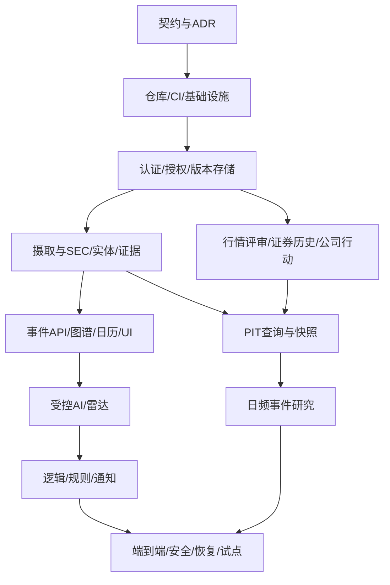

# 分阶段开发计划与可执行任务清单

版本：1.0 · 2026-11-14  
规范优先级：用户已确认约束 > [PRD](01-产品需求说明书-PRD.md) > 本执行计划 > 实现 ADR。若实现发现冲突，记录问题与建议，不能静默削弱 PIT、权限、溯源、授权或数据诚实性。

## 1. 实施假设与排期

计划假设：1 名后端/数据工程师、1 名前端工程师、1 名兼任产品/量化验证负责人，法务和数据采购按需支持；可用 Codex 辅助编码，但不把模型等同于具备签字责任的负责人。以下为工程估算，不是交付承诺。单人开发可按依赖顺序拉长至约 16—24 周；数据采购和历史清洗可能是最长路径。

| 阶段 | 参考周 | 交付与门禁 | 不通过时 |
|---|---|---|---|
| M0 定义与契约 | 1 | ADR、Schema、供应商评审表、mock fixtures、运行骨架 | 继续离线，禁止产生真实统计 |
| M1 可信事件底座 | 2—3 | SEC 试点采集、不可变原文、实体、事件和证据详情 | 保留隔离队列，不启用 AI 自动发布 |
| M2 研究工作台 | 4—5 | 图谱一跳、日历、雷达、可审计分析、状态 UI | 未达 AI 门槛使用人工审阅 |
| M3 PIT 历史验证 | 6—8 | 时间查询、数据快照、公司行动、日频事件研究与反泄漏测试 | 数据不合格则关闭统计，不叫完整生产 MVP |
| M4 决策监控 | 9—10 | 持仓、投资逻辑、规则、站内通知、复盘 | unknown/来源故障不发有效性结论 |
| M5 受邀生产试点 | 11—12 | 权限、安全、性能、备份恢复、授权与合规门禁 | 维持本地/内部测试，不公开推广 |
| V1 扩展 | 试点后约 4—8 周起 | 策略账本回测、授权新闻/预期、只读持仓同步 | 每项单独数据与合规门禁 |
| V2 研究方向 | 无承诺日期 | 分钟级、期权、概率模型、多市场 | 另立立项与样本外验证 |

生产 MVP 完成是 M0—M5 全部验收；M2 的漂亮原型不等于 M3 的可信历史验证。日线供应商可在 M0 评审，授权后的真实数据接入在 M1/M2 期间提前推进，不等到 M3 才发现无历史可用性字段。

关键依赖：



## 2. 建议仓库结构与本地运行约定

```text
apps/web/                         # Next.js UI，消费生成客户端
services/api/app/                 # FastAPI 路由与组合根
services/worker/                  # 队列任务、调度入口
packages/domain/                  # Pydantic领域契约与纯业务规则
packages/contracts/               # 生成JSON Schema/OpenAPI/TS客户端
packages/adapters/                # SEC/FRED/calendar/market/model接口
packages/research/                # PIT、事件研究和统计；不调用LLM
infra/                            # Compose、迁移、部署和监控配置
fixtures/                         # 虚构、版本化、无许可冲突的测试材料
schemas/                          # Schema发布工件与兼容性清单
tests/{contract,integration,pit,security,e2e,eval}/
docs/{adr,runbooks,data-sources,eval-reports}/
.env.example
Makefile
README.md
```

M0 生成并锁定这些命令：`make bootstrap` 安装锁定依赖、`make dev` 启动 mock 栈、`make migrate`、`make seed`、`make check`、`make test-contract`、`make test-pit`、`make test-security`、`make test-e2e`、`make eval-ai`、`make test-load`、`make backup-restore-check`。命令在实现前只是约定，必须在仓库中成为真实可运行目标，不得在交付报告声称已执行尚不存在的命令。

无 key 默认 `DATA_MODE=mock`、`AI_MODE=fixture`，两者返回明确的 metadata。真实来源与 fixture 不共用 namespace，禁止失败后偷偷 fallback 成模拟结果。真实适配器只能用环境变量或 Secret Manager，`.env.example` 只有字段名与无敏感默认值。

## 3. 任务执行规范

每个任务提交：实现、契约变更（如有）、相关迁移、必要测试、运行说明、已知限制。小步推进，一张任务一个可评审变更。完成一项后更新 `docs/implementation-status.md`，记录测试命令、结果、数据模式和下一项。不要把勾选框当成唯一完成证据。

任务规模原则上控制在 0.5—3 人日，若更大先拆分；下列领域任务可按模型、接口、UI 子任务细拆，但保持任务 ID 和验收映射。只有独立工作才可并行实现；跨模块先固定契约。以下“并行”是团队排程建议，不是要求 Codex 自动创建子代理。

### M0：需求冻结、契约与开发骨架

- [ ] **T-001（产品/数据，1日）边界与未决项登记**。依赖：无。产物：`docs/adr/0001-scope.md`、`universe.yml`、法域/数据供应/预算决策表。验收：50公司覆盖范围标为试点，未定项有默认离线策略与负责人，无自动交易依赖。
- [ ] **T-002（后端，2日）领域契约第一版**。依赖：T-001。产物：Event、Fact、Evidence、Instrument、GraphEdge、Calendar、Analysis、ResearchRun、Rule、Notification Schema 与枚举；schema_version 规则。验收：PRD字段齐备，decimal/null/time/unknown语义有正反例，生成客户端无手写重复类型。
- [ ] **T-003（后端，1日）时间与历史模式 ADR**。依赖：T-002。产物：known_at推导表、system/market模式、ALFRED日精度规则、SQL选版本例子。验收：后补录、重述、当代LLM回看旧文三例不会被误标为实际历史信号。
- [ ] **T-004（全栈，2日）可运行仓库、Compose与CI**。依赖：T-002。产物：锁文件、Make targets、health、环境模板、迁移工具。验收：干净机器无外部 key 启动，CI 运行类型/格式/契约/集成测试，mock全局可见。
- [ ] **T-005（数据/采购，2日+外部等待）供应商验收包**。依赖：T-001/T-003。产物：证券历史/退市/公司行动/PIT元数据测试请求、权利矩阵、成本参数表。验收：不接受只给当前复权K线的包作为完整PIT方案；未签授权默认阻断真实行情发布。
- [ ] **T-006（量化/QA，2日）对抗夹具库**。依赖：T-002/T-003。产物：至少20个覆盖修订、ticker变更、停牌、分红、拆股、时区和注入的虚构场景。验收：每例写输入、时间线和预期，不包含未经验证的“历史胜率”。

M0 出口：`make dev` 可启动；Schema 反例验证通过；数据契约与时间 ADR 可评审。尚不宣称已有真实金融研究结果。

### M1：原文、实体、事件与证据

- [ ] **T-101（后端，2日）身份/租户/来源授权底座**。依赖：T-004。产物：OIDC、角色、entitlement、RLS、请求上下文。验收：两个租户相互不可见私有资源；运行DB账号不绕过RLS；连接池复用不串租户。
- [ ] **T-102（后端，2日）不可变原件与证据跨度**。依赖：T-002/T-101。产物：原始/规范化对象、sha256、UTF-8 byte locator、签名URL授权。验收：中文、HTML、表格清洗后引用可复现，原文变动生成新版本；上传受限且可清理孤立对象。
- [ ] **T-103（数据，2日）摄取通用框架**。依赖：T-102。产物：adapter协议、全局限流、watermark、retry/DLQ、outbox。验收：同件重放10次无重复；429/超时重试有上限；崩溃恢复不丢已提交版本。
- [ ] **T-104（数据，2日）SEC试点适配器**。依赖：T-103。产物：submissions与filing附件抓取，accession、CIK和时间精度。验收：共享速率≤配置上限，所有请求含规范User-Agent；源故障不伪造文档；fixture契约测试和经允许的少量真实冒烟分开记录。
- [ ] **T-105（数据，2日）证券实体与别名时间表**。依赖：T-002/T-103。产物：Company/Instrument分离、MIC/ticker有效期、人工歧义队列。验收：换ticker仍同稳定ID；相同ticker不同市场不硬合并；CIK不冒充证券ID。
- [ ] **T-106（后端/数据，3日）事件归一化和版本生命周期**。依赖：T-104/T-105。产物：类型表、精确去重、候选聚类、更正/撤回、质量隔离。验收：AC-01/02；多事件单文档与多文档单事件均支持。
- [ ] **T-107（前端，2日）事件流、详情与证据抽屉**。依赖：T-002，联调依赖T-106。产物：过滤、来源时间、事实/推断标签、六类状态。验收：从列表到原文定位闭环；无数据不填假榜；revision URL可直接打开。

M1 出口：一份来源文档可以安全、幂等地产生有证据的事件并显示；所有依赖仍可用 fixture 离线运行。

### M2：图谱、日历、分析与雷达

- [ ] **T-201（后端，2日）证据图谱一跳**。依赖：T-105/T-106。产物：typed edge、有效期/known_at、来源与review状态。验收：白名单端点约束；历史不存在的边不返回；前端列表可查看每条边的证据。
- [ ] **T-202（数据，2日）BLS/Fed与手工确认日历适配**。依赖：T-103/T-003。产物：revision、confirmation、time_precision、ICS导出。验收：暂定/改期/取消/未知时间、DST和跨日测试通过；不得固定假定会议最后一天一定是决议时刻。
- [ ] **T-203（后端，3日）受控AI编排和审计**。依赖：T-102/T-106/T-101。产物：只读检索、结构化输出、引用/数值/时间校验、预算与审计。验收：Schema错误、refusal、超时和无证据均可降级；模型输出不能直接发布事实或执行外部文档指令。
- [ ] **T-204（量化/QA，3日）AI评估集和发布门禁**。依赖：T-203。产物：100案例开发评估+30留出、人工标注协议、报告脚本。验收：报告实际结果与分母；不达PRD门槛自动发布flag关闭；人工审阅可继续使用。
- [ ] **T-205（后端，2日）偏好和确定性雷达**。依赖：T-201/T-202。产物：pref版本、5项特征、radar_run、分项解释。验收：同输入排序一致、缺项规则一致、授权先过滤；分数不得显示百分号。
- [ ] **T-206（前端，3日）工作台、日历、资产页面**。依赖：T-107；联调T-201/202/205。产物：桌面/移动适配、时区切换、解释抽屉。验收：AC-05/06可由界面完成，键盘可访问，mock/stale清晰。

M2 出口：研究工作台完整可演示；AI评估不合格时使用待审；历史统计入口可显示真实的数据阻断状态。

### M3：PIT 和日频事件研究

- [ ] **T-301（数据，3日）行情适配与公司行动**。依赖：T-005/T-105。产物：raw bars、vendor revision、actions、delist终值与license propagation。验收：拆股/分红/停牌/退市夹具对账；未经授权真实数据关闭；缺字段不能用当前版本冒充历史。
- [ ] **T-302（数据，2日）FRED/ALFRED版本读取**。依赖：T-003/T-103。产物：vintage、实时区间、series上下文、时间精度与原始响应。验收：早期as_of不读后续修订；日期精度仅用于保守后续会话；不从发布日期推断网站秒级可用性。
- [ ] **T-303（后端/量化，3日）PIT仓储层与快照manifest**。依赖：T-301/T-302/T-106/T-201。产物：统一as_of查询、knowledge_mode、依赖哈希、input_max_known_at。验收：时间线对抗夹具均通过；特征和outcome访问分开；不允许research包绕过仓储取当前表。
- [ ] **T-304（量化，3日）事件研究引擎**。依赖：T-303。产物：固定样本过滤、入场/退出日历、公司行动、成本和基准计算。验收：手工可算的小账本逐笔对账；signal正好等于open时不在该open入场；h=1定义一致；无行情不返回统计。
- [ ] **T-305（量化，2日）统计与偏差披露**。依赖：T-304。产物：各h样本数、排除原因、分位数、日期聚类区间、n<30屏蔽、pending标签。验收：重叠事件处理固定且可追溯；成熟样本门禁；返回样本比例不称未来胜率。
- [ ] **T-306（后端/前端，3日）研究异步API和页面**。依赖：T-304/T-305。产物：create/poll/cancel、manifest、样本分页、权限/配额。验收：运行创建后不能改配置；导出不越权；失败可定位；阻断码可读。
- [ ] **T-307（QA/量化，2日）PIT反泄漏红队验证**。依赖：T-303—306。产物：财报重述/宏观修订/ticker/历史关系/模型后见等测试。验收：人为注入未来数据时测试必须失败；从固定快照重跑数值一致；实际真实数据覆盖率独立报告。

M3 出口：可信、可复算的日频事件研究；仅mock通过时标记“工程引擎验收”，必须等真实数据授权与覆盖评审才能签收生产历史研究。

### M4：用户决策、监控与复盘

- [ ] **T-401（全栈，2日）自选/持仓与CSV预览提交**。依赖：T-101/T-105/T-206。产物：版本化持仓、导入错误、幂等commit、价格时效。验收：数量/币种/映射错误不能悄悄通过；旧行情不显示实时组合风险。
- [ ] **T-402（后端，2日）投资逻辑卡与条件DSL**。依赖：T-106/T-401。产物：条件AST白名单、论点版本、true/false/unknown、用户确认状态。验收：自由文本无法执行代码；缺数据unknown；用户手动终结有审计。
- [ ] **T-403（后端，2日）监控重评与站内通知**。依赖：T-402/T-103。产物：rule evaluation、dedup/outbox、静默时段、来源更正重评。验收：重复消费不重复通知；修订发送更正且旧触发保留；无数据只提示待复核。
- [ ] **T-404（前端，2日）风险、逻辑和复盘页面**。依赖：T-401—403。产物：直接/行业关联、风险覆盖率、条件编辑、触发时间线、反馈。验收：用户可解释为何收到提醒；不生成无模型基础的亏损概率。
- [ ] **T-405（后端/前端，2日）数据运维后台**。依赖：T-106/T-203。产物：隔离队列、来源水位、实体歧义、审阅/更正、授权过期。验收：管理员默认不能查看私有持仓；重放幂等且更正有原因。

M4 出口：用户可完成“关注—建论点—触发—复核—复盘”，无自动交易。

### M5：生产试点门禁

- [ ] **T-501（QA，2日）关键端到端验收**。依赖：M1—M4。产物：AC-01—12逐项证据，分别记录fixture和真实模式。验收：核心流程无阻断，真实数据未接入的能力不得标完成。
- [ ] **T-502（安全/后端，2日）跨租户与攻击测试**。依赖：T-101/T-203/T-306/T-405。产物：API/RLS/缓存/向量/对象URL/job越权测试，CSV/XSS/SSRF/注入用例。验收：关键泄漏为0，日志无key/持仓正文；签名URL失效与许可撤销验证。
- [ ] **T-503（工程，2日）监控、压测与成本**。依赖：T-501。产物：PRD固定负载压测、来源lag看板、队列/成本预算告警、429与熔断演练。验收：实际p95和硬件记录；超标有修复或范围限制，不编造达标数。
- [ ] **T-504（运维，2日）迁移、备份恢复与回滚**。依赖：T-503。产物：runbook、DB+对象备份恢复、旧版本部署回滚演练。验收：恢复后引用和manifest可访问；RPO/RTO实测；不把镜像回滚当作数据自动回滚。
- [ ] **T-505（产品/法务/采购，外部依赖）商业上线评审**。依赖：T-005及真实功能范围。产物：数据合同权利矩阵、运营/用户法域评估、隐私、营销和研究披露。验收：每个开启feature对应许可与责任人，未决功能关闭。
- [ ] **T-506（产品，5个交易日以上）受邀试用与签收**。依赖：T-501—505。产物：≥5名目标用户任务记录、研究耗时/提醒反馈、费用、缺陷和下一版决策。验收：无P0缺陷，无未经授权数据展示；报告效果是实测而非预设目标。

## 4. V1 / V2 工作包

V1 每项独立评审，不因进入路线图就默认获准上线：

- [ ] **V1-01 策略级日频回测**：依赖T-307；新增现金/持仓/成交账本、资金约束、样本外走步、purge/embargo和成本敏感性；手算账本和基线策略对账后才显示收益曲线。
- [ ] **V1-02 授权一致预期与 surprise**：获取发布前快照、修订和字段口径；同时间/同口径验证；没有历史快照不回填。
- [ ] **V1-03 新闻与电话会**：完整授权、来源独立性、重发/更正、说话人识别、检索引用；新模态单独评估。
- [ ] **V1-04 供应链二跳图谱**：业务分部/客户供应商关系的有效期和证据；解释间接路径，拒绝精确但无依据的营收敞口数字。
- [ ] **V1-05 只读券商同步**：OAuth最小权限、撤销与同步冲突；不接交易权限；经纪商授权和法域另审。
- [ ] **V1-06 订阅与团队协作**：席位/账单/退款/共享授权、审计和跨团队数据许可，不将购买席位等同于行情许可。

V2：分钟/逐笔级数据、期权和波动率结构、学习排序、概率预测、多资产情景风险。每项先验证数据成本、独立样本、评估方案与法务门禁，另立PRD。概率模型至少报告样本外校准、分层误差、漂移和失效策略；没有证据不能许诺预测准确率。

## 5. 测试矩阵与交付物

| 层级 | 必须覆盖 | 运行时点 |
|---|---|---|
| 契约 | Schema、decimal、null、enum、时间精度、生成TS差异 | 每次相关变更 |
| 单元 | 交易日入场、成本、公司行动、条件三值逻辑、雷达特征 | 业务规则变更 |
| 集成 | DB版本查询、RLS、outbox、对象引用、worker幂等 | 每次合并 |
| PIT | 后补录、修订、退市、历史关系、未成熟outcome、LLM后见 | 研究/数据/模型发布 |
| AI评估 | claim支持、数字/单位、无证据、注入、留出集 | 提示词/模型/检索发布 |
| E2E | 事件→引用→研究→建论点→提醒；真实与mock分开 | 每次发布 |
| 可靠性 | 来源超时、429、队列崩溃、预算耗尽、授权撤销 | 试点前及相关变更 |
| 安全 | 租户/权限/URL/缓存/检索/job、上传与SSRF | 每次相关变更和试点前 |
| 恢复/性能 | 固定负载、恢复、回滚、对象与DB一致性 | 首次生产和架构变更 |

最低交付物：运行代码、迁移、锁定契约与客户端、fixtures、必要测试、AI评估报告、数据PIT覆盖报告、授权矩阵、ADR、API例子、运维与恢复手册、成本模型、已知限制。不要为了勾选覆盖率编写只复述实现的测试；金融金额、时间、权限和幂等要用独立预期结果验证。

## 6. 风险、阻塞与取舍规则

| 风险 | 预防/检测 | 执行取舍 |
|---|---|---|
| 无历史供应商可用时刻 | T-005先评审、T-303拒绝无证明数据 | 允许描述研究，不标真实系统历史绩效 |
| 只有当前幸存公司 | universe历史与退市覆盖报告 | 标限定集合偏差，禁做全市场结论 |
| AI文字流畅但无依据 | 引用+数值+人工评估+发布门禁 | 降级人工审阅，保留原文功能 |
| 数据授权慢或昂贵 | adapter接口+mock模式+功能flag | 做完工程，关闭未授权生产能力 |
| 范围膨胀 | M0范围表、每项V1立项 | 不用扩功能替代底层正确性 |
| 单人开发过载 | 按依赖做垂直闭环，小步签收 | 延长日程，保留安全和PIT门禁 |
| 上游日历临时改期 | revisions和定期重查 | 更正通知，撤销旧待发提醒 |
| 模型或数据商不可用 | 预算、熔断、隔离、stale可见 | 原文与人工工作流继续可用 |

本阶段不需采购和部署也能完成M0与离线代码。到必须真实接入时才提出具体供应商、权利、费用和部署环境的决策；不要反复向用户索取已授权的普通工程操作确认。
